<div align="center">



# GitBoot

**Give your GitHub profile a terminal boot screen.**
Customize it in your browser, copy two lines into your profile README. Nothing to install.

[](../../actions/workflows/ci.yml)
[](LICENSE)
[](CONTRIBUTING.md)

</div>

---

## Why GitBoot?

- **Zero install.** It runs entirely in the browser. No backend, no account, no token.
- **Animated SVG, not a GIF.** A few kB instead of several MB, crisp at any size, works inside a GitHub README.
- **What you see is what you export.** The live preview and the exported file come from the same renderer.
- **Shareable.** Your whole config lives in the URL. Send a link, get the same boot screen.
- **Open and hackable.** Small TypeScript codebase, themes are plain objects.

## Themes

<table>
<tr>
<td align="center"><b>matrix</b><br></td>
<td align="center"><b>cyberpunk</b><br></td>
</tr>
<tr>
<td align="center"><b>classic</b><br></td>
<td></td>
</tr>
</table>

## Use it in 30 seconds

1. Open the generator and tweak the username, logo, messages, theme, speed and effects.
2. Click **Download SVG** and save it as `assets/boot.svg` in your profile repository (`<you>/<you>`).
3. Click **Copy Markdown** and paste it into your `README.md`.

```html
<div align="center">
  
</div>
```

## Run it locally

```bash
git clone https://github.com/<owner>/gitboot.git
cd gitboot
npm install
npm run dev
```

| Command             | What it does                                  |
| ------------------- | --------------------------------------------- |
| `npm run dev`       | Start the generator with hot reload           |
| `npm test`          | Run the unit tests                            |
| `npm run build`     | Type-check and build the static site          |
| `npm run examples`  | Regenerate the demo SVGs in `assets/`         |

## How it works

```
Config  ->  Timeline  ->  SVG renderer  ->  boot.svg
(JSON)     (events)       (CSS keyframes)
```

- [`src/config.ts`](src/config.ts): config schema, validation, URL encoding
- [`src/engine/timeline.ts`](src/engine/timeline.ts): pure function turning a config into timed screen events
- [`src/engine/svg.ts`](src/engine/svg.ts): turns a timeline into a self-contained animated SVG
- [`src/themes/`](src/themes/index.ts): color palettes and effects

## Roadmap

- [x] Live preview, shareable URL, SVG and Markdown export
- [x] Themes: classic, matrix, cyberpunk
- [ ] GIF / WebP export
- [ ] More themes (retro CRT, Windows, minimal)
- [ ] Image to ASCII logo
- [ ] Custom ASCII logo and fonts
- [ ] "Deploy to GitHub" via OAuth
- [ ] Community template gallery

Have an idea? [Open an issue](../../issues/new/choose).

## Contributing

New themes are the easiest and most welcome contribution. See [CONTRIBUTING.md](CONTRIBUTING.md).

## License

[MIT](LICENSE)

---

<div align="center">

If GitBoot made your profile cooler, a ⭐ helps others find it.

</div>
